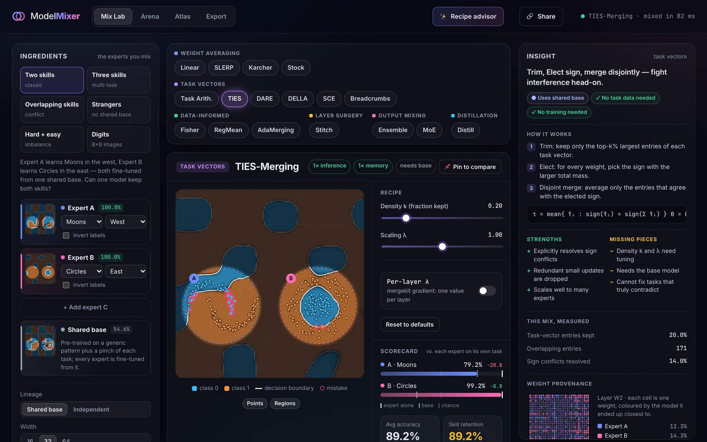
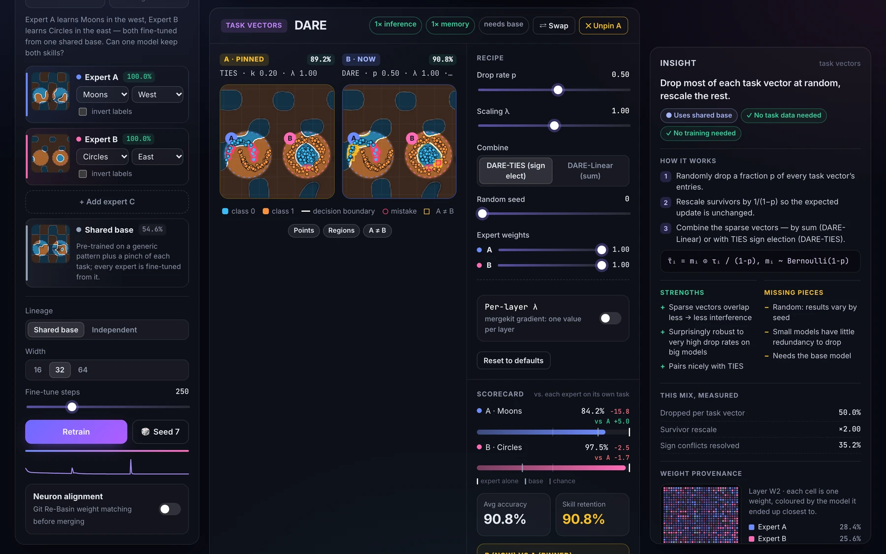
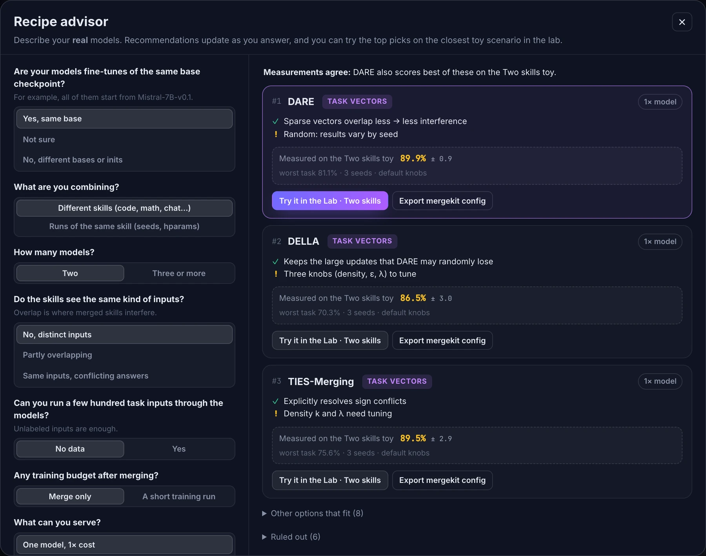
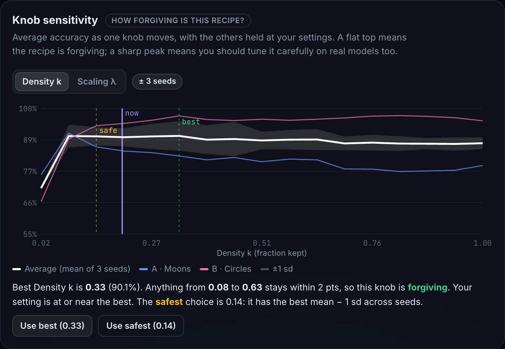
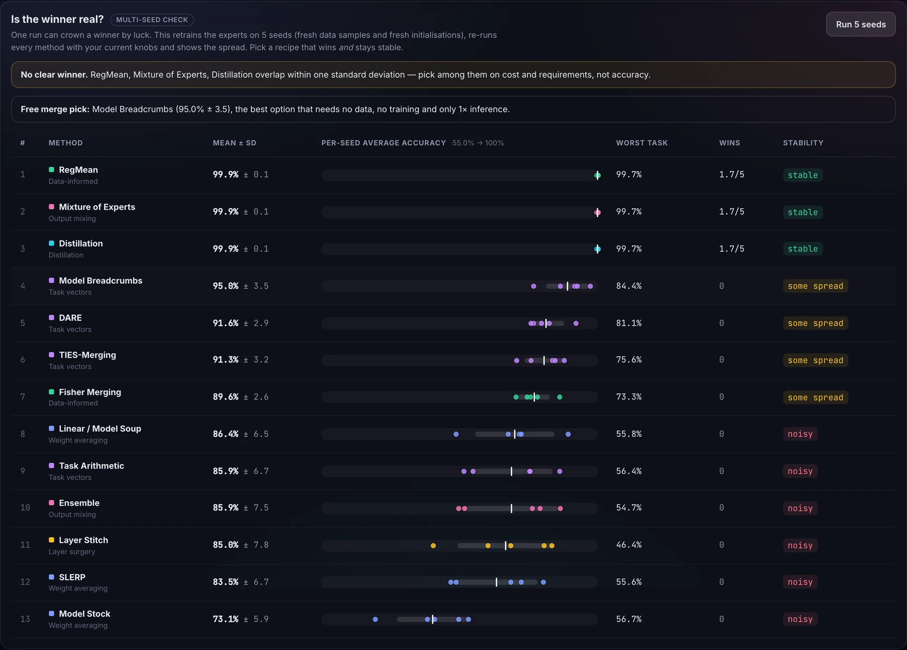
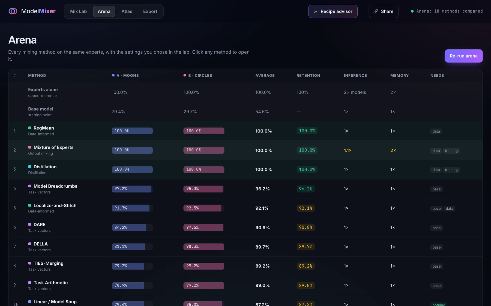
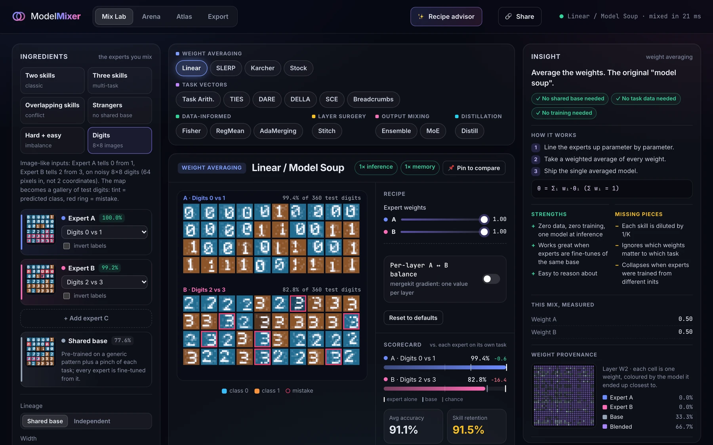

# ModelMixer

[](https://github.com/venkymullapudi/ModelMixer/actions/workflows/ci.yml) [](https://github.com/venkymullapudi/ModelMixer/actions/workflows/pages.yml)

**An interactive lab for model merging.** Train a few small expert networks in your browser, mix them
with 18 different techniques, and *see* what each mix keeps, loses and needs — then export the same
recipe as a [mergekit](https://github.com/arcee-ai/mergekit) config for real Hugging Face models.

**▶ Live demo: <https://venkymullapudi.github.io/ModelMixer/>**

No install, no server, no dependencies: everything (training, merging, evaluation, plots) runs in plain
JavaScript in the browser. It is keyboard-navigable and screen-reader labelled (axe-core: 0 violations). First-time visitors get a short skippable tour (the **?** button replays it). Training and multi-seed scoring run in Web Workers, with independent seeds in parallel, so the page stays responsive.



## Screenshots

| | |
| --- | --- |
|  |  |
| **Pin to compare.** Freeze a recipe as A, tweak B: both maps, where they disagree (amber), and a paired check of whether B's edge is real. | **Recipe advisor.** Describe your real models and get ranked recipes, measured on the closest toy and re-ranked when the measurement clearly disagrees with the rules. |
|  |  |
| **Knob sensitivity.** How forgiving is each knob? Best and safest settings, with a seed band that exposes lucky peaks. | **Is the winner real?** Every method retrained on 3–10 seeds: mean ± sd, wins, stability and a paired head-to-head. |
|  |  |
| **Arena.** Every method on the same experts: accuracy, retention, inference cost, memory and requirements. | **Digits.** Image-like 8×8 inputs; the map becomes a gallery of test digits, and the method ranking changes. |

## Run it

Use the [live demo](https://venkymullapudi.github.io/ModelMixer/), or open `dist/modelmixer.html` (a single self-contained file) in any modern browser. Recipe links from 🔗 Share work on the live demo as normal https URLs.

Or work from the sources:

```bash
python3 -m http.server 8000
```

then visit <http://localhost:8000>. Opening `index.html` directly via `file://` also works.
After editing anything in `js/` or `css/`, rebuild the single-file version with:

```bash
python3 scripts/bundle.py
```

## What's inside

| Tab | What it does |
| --- | --- |
| **Mix Lab** | Pick a scenario and experts, choose a mixing method, tune its knobs live. **Per-layer values** (mergekit gradients) for SLERP t, Linear balance and task-vector λ, exported as `t: [0.25, 0.50, 0.75]`-style lists, plus a **per-layer heat map** that shows which layer the recipe is sensitive to and offers best and safest settings. Undo / redo (⌘Z / ⇧⌘Z) makes exploring safe. **Knob sensitivity** sweeps the active knob and marks the best and safest settings, with an optional ± 5-seed band that also says whether the best value holds, transfers or moves from seed to seed. **Pin to compare** freezes a recipe as A so you can tweak B and see both decision maps side by side, with per-task deltas, an amber map of where A and B disagree, and a one-click paired 5-seed check of whether B's edge is real. See the merged model's decision boundary, a per-task scorecard against each expert and the base, what the method needs, how it works, its strengths and *missing pieces*, a weight-provenance map and task-vector geometry. |
| **Arena** | Every method on the same experts: leaderboard (accuracy, retention, inference cost, memory, requirements), a **multi-seed robustness check** (3, 5 or 10 seeds: mean ± sd, wins and stability, a verdict on whether the winner is real, a paired **head-to-head** between any two methods, and CSV export), a gallery of decision maps, the A→B interpolation path (loss barriers, with and without neuron alignment) and a λ sweep for Task Arithmetic / TIES / DARE. |
| **Report** | 📄 in the top bar turns the current recipe into one printable page (PDF, HTML or Markdown): settings, results with the decision map, any checks you ran (sensitivity, multi-seed, comparison), method notes and the mergekit config. Hand it to a teammate before the real merge. |
| **Share** | 🔗 in the top bar copies a link (`…/modelmixer.html#r=…`) that reopens the exact recipe: experts, training settings, method, knobs, alignment and any pinned comparison. The address bar stays in sync too. |
| **Recipe advisor** | ✨ in the top bar: answer 8 questions about your real models (shared base? data? training budget? how you serve?) and get ranked recipes with reasons, caveats and ruled-out methods. Each pick is also measured over the same 5 seeds the Lab's checks use, on the closest toy scenario: points on a plane, 8×8 digits, or both, and with both the advisor flags when the two kinds of data disagree. If a lower pick beats the rules' #1 on the paired test, it is re-ranked to #1, and the verdict says why. Open a pick in the Lab on the closest scenario, or jump to Export. |
| **Atlas** | A **recipe gallery** of one-click A-vs-B lessons (each test-guarded), a capability matrix (needs base? data? training? single-model inference? tolerates different inits? handles interference?), a "which mix should I reach for" guide, method families and a glossary. A measured **“Which knobs transfer across seeds?”** table says which toy-optimal knob values hold from seed to seed and which you must tune on your own models. |
| **Export / Import** | Generates the matching mergekit (`mergekit-yaml` / `mergekit-moe`) config from your lab recipe, plus pointers to open-source implementations for methods mergekit doesn't cover. **Import** goes the other way: paste a mergekit YAML (including gradient lists, passthrough slices and mergekit-moe) to load it as a Lab recipe, with anything approximated spelled out. |

### Mixing methods

| Family | Methods |
| --- | --- |
| Weight averaging | Linear / Model Soup, SLERP, Karcher mean (multi-model SLERP), Model Stock |
| Task vectors | Task Arithmetic, TIES-Merging, DARE (TIES / Linear), DELLA, SCE, Model Breadcrumbs |
| Data-informed | Fisher merging, RegMean, AdaMerging (λ tuned on unlabeled inputs; about +12 pts over Task Arithmetic on the Digits toy), Localize-and-Stitch (sparse per-task masks) |
| Layer surgery | Layer Stitch (Frankenmerge / passthrough) |
| Output mixing | Ensemble, Mixture of Experts (learned router, top-1 or soft) |
| Distillation | Student distilled from an MoE or ensemble teacher |
| Pre-step | Git Re-Basin neuron alignment (weight matching + Hungarian algorithm) |

### Scenarios

- **Two skills / Three skills**: experts fine-tuned from one shared base, each learning a skill in its own region.
- **Overlapping skills**: two skills in the same place that disagree. No mix can satisfy both, and a router can't tell them apart.
- **Strangers**: experts trained from different random inits. Task-vector methods are unavailable and plain averaging breaks until you turn on neuron alignment.
- **Hard + easy**: a hard spiral next to easy blobs, which shows how merges wash out large updates.
- **Digits**: image-like inputs. Experts tell 0 from 1 and 2 from 3 on noisy 8×8 digits, with 64 pixels in instead of 2 coordinates. The map becomes a gallery of test digits, and the method ranking changes noticeably from the plane toys. The insight panel adds **pixel saliency**: which pixels each merge reads, compared with the expert.
- **Digits conflict**: A tells 0 from 1 and B tells 1 from 7. Both see 1s and disagree on them, so even the best merges reach only about 73%.

You can also change any expert's skill, region, label inversion, network width and fine-tuning length. Digit skills come in six digit pairs.

## How the toy works

Each expert is a small MLP (radial-basis input encoder → 2 hidden tanh layers → logit). The shared base is
pre-trained on a generic "general knowledge" pattern plus a pinch of each task, and each expert is fine-tuned
from it with SGD+momentum. That keeps task vectors fairly local, which is what makes weight-space merging
meaningful, much like fine-tunes of a large pretrained model. Independent experts are trained from scratch with Adam.

Every number on screen is computed live: accuracies on held-out test points, TIES sign conflicts, Fisher
information, RegMean Gram matrices, router accuracy and alignment permutations.

## Tests

```bash
node tests/run.js
```

The suite checks the Hungarian solver against brute force, that weight matching exactly undoes a neuron
shuffle, that training is deterministic, that every method clears an accuracy floor, and that alignment
helps the Strangers scenario. CI (GitHub Actions) runs it on every push and also fails if
`dist/modelmixer.html` is out of date. A second CI job runs three browser gates in Playwright's Chromium: an axe-core
accessibility audit of every view (`scripts/axe_audit.py`), a keyboard-only recipe flow (`scripts/keyboard_audit.py`:
skip links, scenario, method, pin, knob, undo, edge check, export, advisor, with a visible focus ring at every stop) and a 375 px
phone-layout audit (`scripts/phone_audit.py`). The Atlas's pre-measured knob-transfer snapshot (`js/transfer-snapshot.js`, made by `scripts/transfer_snapshot.py`) must match the engine: CI fails if an engine file changes without re-measuring.
Locally they use your Google Chrome (`pip install playwright`). No Node? Run `python3 scripts/bundle.py --tests` and open
`tests/_browser.html`.

## Deploying and screenshots

- **GitHub Pages:** `.github/workflows/pages.yml` rebuilds the single-file app on every push to `main` and publishes it as
  the site's `index.html`. One-time setup: *Settings → Pages → Build and deployment → Source: GitHub Actions*.
- **Screenshots:** `python3 scripts/screenshots.py` (needs `pip install playwright pillow` and Google Chrome)
  re-captures `docs/screenshots/*.webp` from `dist/modelmixer.html`.

## Project layout

```
index.html          app shell
css/styles.css      styles (dark UI)
js/nn.js            MLP, RBF encoder, Adam/SGD, Fisher, Gram matrices
js/data.js          tasks, regions, scenarios
js/methods.js       method catalog: how it works, pros, missing pieces, requirements, OSS links
js/merge.js         merge engine + Git Re-Basin + router + distillation
js/lab.js           headless core: train experts, build contexts, score methods, seed summaries
js/advisor.js       recipe advisor rules (situation → ranked methods)
js/share.js         recipe ⇄ URL-safe link encoding with strict validation
js/mkimport.js      mergekit YAML → lab recipe (YAML-subset parser + method mapper)
js/report.js        recipe report builder (self-contained HTML + Markdown)
js/gallery.js       curated A-vs-B example recipes with test-guarded lessons
js/viz.js           decision-boundary canvases, provenance maps, SVG charts
js/app.js           state, training loop, Lab / Arena / Atlas / Export views
scripts/bundle.py   inlines everything into dist/modelmixer.html (--tests: browser test page)
scripts/screenshots.py  regenerates docs/screenshots/ with Playwright
tests/              engine test-suite (Node runner + browser-compatible suite)
IMPROVEMENTS.md     prioritised backlog
```

## Open-source references

- [mergekit](https://github.com/arcee-ai/mergekit): linear, SLERP, Karcher, task arithmetic, TIES, DARE, DELLA, SCE, breadcrumbs, model stock, passthrough, MoE
- [FusionBench](https://github.com/tanganke/fusion_bench): benchmark suite including Fisher, RegMean and AdaMerging
- [git-re-basin](https://github.com/samuela/git-re-basin): permutation alignment
- [dataless-model-merging](https://github.com/bloomberg/dataless-model-merging): RegMean
- [Localize-and-Stitch](https://github.com/uiuctml/Localize-and-Stitch): sparse task-vector localization
- [DistillKit](https://github.com/arcee-ai/DistillKit), [TRL](https://github.com/huggingface/trl): distillation

## License

Apache-2.0, see [LICENSE](LICENSE).
